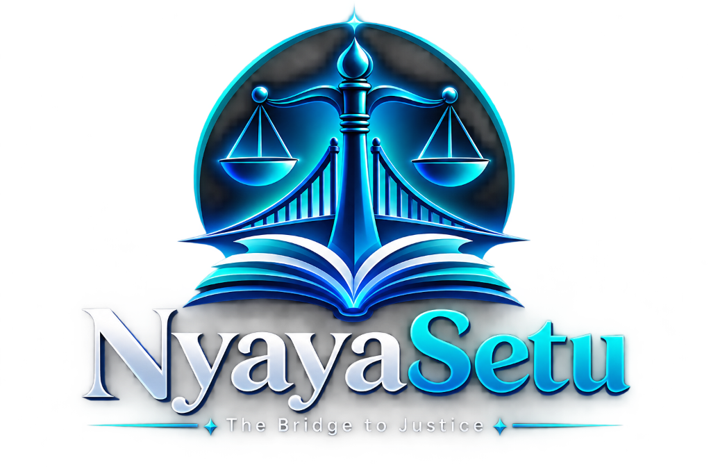
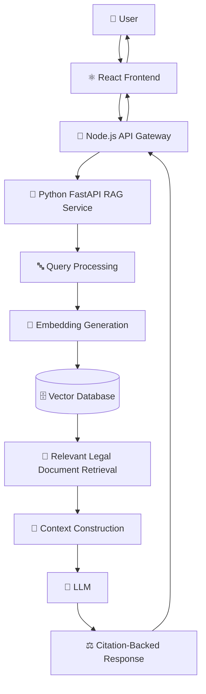
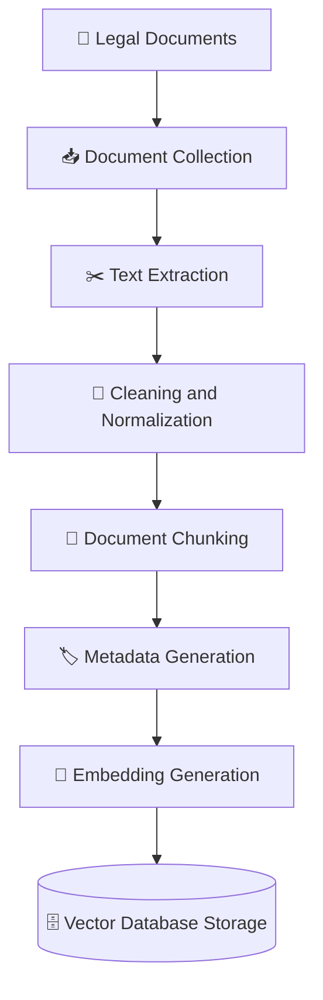

<div align="center">



<br />

> An AI-Powered RAG-Based Legal Assistant for Accessible, Explainable, and Citation-Backed Legal Knowledge in India

**B.Tech Final Year Project**

[](LICENSE)


</div>

---

## 📑 Table of Contents

- [Overview](#-overview)
- [Problem Statement](#-problem-statement)
- [Core Objectives](#-core-objectives)
- [Key Features](#-key-features)
- [Legal Coverage](#-legal-coverage)
- [System Architecture](#-system-architecture)
- [RAG Pipeline](#-rag-pipeline)
- [Repository Structure](#-repository-structure)
- [Technology Stack](#-technology-stack)
- [Installation Guide](#-installation-guide)
- [Environment Configuration](#-environment-configuration)
- [API Documentation](#-api-documentation)
- [Data Ingestion Pipeline](#-data-ingestion-pipeline)
- [Evaluation Methodology](#-evaluation-methodology)
- [User Interface](#-user-interface)
- [Project Status](#-project-status)
- [Future Roadmap](#-future-roadmap)
- [Contributing](#-contributing)
- [Code Quality](#-code-quality)
- [Responsible AI & Privacy](#-responsible-ai--privacy)
- [Legal Disclaimer](#-legal-disclaimer)
- [Documentation](#-documentation)
- [License](#-license)
- [Author](#-author)
- [Acknowledgements](#-acknowledgements)

---

## 🧭 Overview

NyayaSetu ("Nyaya" = Justice, "Setu" = Bridge) is an AI-powered legal assistant built to improve access to understandable legal knowledge in India. It uses Retrieval-Augmented Generation (RAG) to ground every response in actual legal source material, rather than relying on a language model's unverified memory.

Instead of returning generic or potentially hallucinated legal information, NyayaSetu retrieves relevant excerpts from Indian legal texts — statutes, codes, and acts — and uses them as grounding context for generating clear, citation-backed answers to legal questions.

NyayaSetu is being developed as a B.Tech Final Year Project, with the long-term intention of evolving into a genuinely useful, extensible legal information platform for Indian citizens, students, and researchers.

> **⚠️ NyayaSetu is a legal information and research assistance tool. It does not replace professional legal advice from a qualified lawyer or advocate.** See the [Legal Disclaimer](#-legal-disclaimer) section for details.

---

## ❓ Problem Statement

Access to legal knowledge in India is fragmented and difficult for non-experts to navigate:

- Legal language is dense, procedural, and inaccessible to most citizens.
- Statutes and codes are scattered across many official and unofficial sources, with inconsistent formatting.
- General-purpose AI chatbots frequently hallucinate legal facts, case citations, or sections that do not exist.
- There is no easy way for a layperson to ask a legal question and receive an answer that is both understandable and traceable back to an actual legal source.

NyayaSetu addresses this gap by combining conversational AI with retrieval-grounded generation, so that every answer can be traced back to the specific legal text it was derived from.

---

## 🎯 Core Objectives

- 📚 **Improve accessibility** to Indian legal knowledge for non-experts.
- 🗣️ **Simplify complex legal language** into understandable explanations.
- 🔗 **Provide source-grounded, citation-backed responses.**
- 🛡️ **Reduce hallucinations** through Retrieval-Augmented Generation.
- 💬 **Support natural, conversational legal queries.**
- 🔍 **Enable explainable AI-assisted legal information retrieval.**
- 🧩 **Build a scalable, modular architecture** that allows the legal knowledge base to grow over time.

---

## ✨ Key Features

| Feature | Description | Status |
| :--- | :--- | :--- |
| 🔍 **Semantic Legal Search** | Retrieves legally relevant passages using vector similarity rather than plain keyword matching | Planned |
| ⚖️ **Citation-Backed Responses** | Every generated answer references the specific act/section it was derived from | Planned |
| 🧠 **Retrieval-Augmented Generation** | Combines retrieval with LLM generation to reduce hallucination | Planned |
| 📚 **Indian Legal Knowledge Base** | Curated collection of Indian statutes and codes (see Legal Coverage) | In Progress |
| 💬 **Conversational Legal Interface** | Chat-style interface for asking legal questions in natural language | Planned |
| 🔎 **Explainable Responses** | Responses are structured to show why an answer was generated, not just what the answer is | Planned |
| 🛡️ **Hallucination Reduction** | Grounded retrieval reduces the likelihood of fabricated legal claims | Planned |
| 📖 **Source-Based References** | Retrieved legal passages are surfaced alongside the generated answer | Planned |
| ⚡ **API-Based Microservice Architecture** | Decoupled frontend, gateway, and RAG service for scalability | In Progress |
| 🧩 **Modular Design** | Each service (frontend, backend, RAG) can be developed and scaled independently | In Progress |
| 📱 **Responsive UI** | Usable across desktop and mobile viewports | Planned |
| 🔄 **Expandable Knowledge Base** | New statutes can be added to the ingestion pipeline without architectural changes | Planned |

---

## 🏛️ Legal Coverage

NyayaSetu's legal knowledge base is designed to be incrementally expandable. The table below reflects the statutes currently targeted for ingestion — inclusion here means the law is planned or in progress for the knowledge base, not that full retrieval support is complete. See Project Status for implementation status.

| Category | Supported / Planned Laws |
| :--- | :--- |
| **Constitutional Law** | Constitution of India |
| **Criminal Law** | Bharatiya Nyaya Sanhita, 2023 |
| **Criminal Procedure** | Bharatiya Nagarik Suraksha Sanhita, 2023 |
| **Evidence Law** | Bharatiya Sakshya Adhiniyam, 2023 |
| **Consumer Law** | Consumer Protection Act, 2019 |
| **Cyber Law** | Information Technology Act, 2000 |
| **Child Protection Law** | Protection of Children from Sexual Offences Act, 2012 |
| **Motor Vehicle Law** | Motor Vehicles Act, 1988 |

> New categories and statutes can be added by extending the `evaluation/` and ingestion metadata schema described in [Data Ingestion Pipeline](#-data-ingestion-pipeline). Additional statutes are tracked in the [Future Roadmap](#-future-roadmap).

---

## 🏗️ System Architecture

NyayaSetu follows a microservice architecture with three primary layers: a React frontend, a Node.js API gateway, and a Python FastAPI RAG service backed by a vector database.



Layer responsibilities:
- **Frontend (React + Vite)**: Renders the conversational interface, handles user input, and displays citation-backed answers.
- **Backend / API Gateway (Node.js + Express)**: Routes requests between the frontend and the RAG service, handles application-level concerns (validation, session handling, rate limiting).
- **RAG Service (Python + FastAPI)**: Owns the retrieval and generation pipeline — query processing, embedding, vector search, prompt construction, and LLM invocation.
- **Vector Database (ChromaDB / FAISS)**: Stores embedded legal document chunks for semantic retrieval.

---

## 🔬 RAG Pipeline

The core of NyayaSetu is its Retrieval-Augmented Generation pipeline, which grounds every response in retrieved legal text rather than relying purely on the LLM's parametric knowledge.


| Stage | Description |
| :--- | :--- |
| **1. User Query** | The user asks a legal question through the NyayaSetu interface. |
| **2. Query Processing** | The raw query is cleaned, normalized, and prepared for semantic retrieval. |
| **3. Embedding Generation** | The processed query is converted into a semantic vector using `BAAI/bge-small-en-v1.5`. |
| **4. Semantic Retrieval** | The vector database is searched for the most semantically relevant legal document chunks. |
| **5. Context Selection** | Retrieved passages are ranked and filtered to the most relevant subset. |
| **6. Prompt Construction** | Selected legal context is combined with the user's query and system instructions into a structured prompt. |
| **7. LLM Generation** | The language model generates a response grounded in the retrieved context. |
| **8. Citation Generation** | The response is annotated with references to the specific legal sources used. |
| **9. Response Delivery** | The final answer, along with its citations, is returned to the frontend via the backend gateway. |

---

## 📁 Repository Structure

```text
NyayaSetu/
├── frontend/          # React + Vite user interface
├── backend/           # Node.js + Express API gateway
├── rag-service/       # Python + FastAPI RAG pipeline
├── evaluation/        # RAG evaluation scripts and test data
├── docker/            # Dockerfiles and container configuration
├── docs/              # Project documentation
├── docker-compose.yml
└── README.md
```

| Directory | Purpose |
| :--- | :--- |
| `frontend/` | The React + Vite web client. Hosts the chat interface, citation display, and all user-facing UI components. |
| `backend/` | The Node.js + Express API gateway. Sits between the frontend and the RAG service, handling routing, validation, and cross-cutting concerns. |
| `rag-service/` | The Python + FastAPI microservice implementing the RAG pipeline — query processing, embedding, retrieval, prompt construction, and LLM invocation. |
| `evaluation/` | Scripts and datasets used to evaluate retrieval quality, faithfulness, and answer relevance (see Evaluation Methodology). |
| `docker/` | Dockerfiles and container configuration for each service. |
| `docs/` | Extended project documentation (architecture, setup, API reference, etc.). See Documentation. |
| `docker-compose.yml` | Orchestrates all services for local or containerized deployment. |

---

## 🛠️ Technology Stack

### Frontend
- React 19
- Vite 6
- Modern, responsive web interface

### Backend / API Gateway
- Node.js 20
- Express 4

### RAG Service
- Python 3.11
- FastAPI

### LLM
- Google Gemini (planned / configurable)

### Embeddings
- Sentence Transformers
- `BAAI/bge-small-en-v1.5`

### Vector Database
- ChromaDB
- FAISS (optional, for experimentation or as an alternative vector store)

### AI / RAG Framework
- LangChain (where appropriate)

### Deployment
- Docker
- Docker Compose

---

## 🚀 Installation Guide

### Prerequisites
- Node.js 20+
- Python 3.11+
- npm
- Git
- Docker and Docker Compose (optional, for containerized setup)

### Clone the Repository
```bash
git clone https://github.com/YOUR_USERNAME/NyayaSetu.git
cd NyayaSetu
```

### Frontend Setup
```bash
cd frontend
npm install
npm run dev
```

### Backend Setup
```bash
cd backend
npm install
npm run dev
```

### RAG Service Setup

**Windows:**
```bash
cd rag-service
python -m venv venv
venv\Scripts\activate
pip install -r requirements.txt
uvicorn main:app --reload --port 8000
```

**macOS / Linux:**
```bash
cd rag-service
python3 -m venv venv
source venv/bin/activate
pip install -r requirements.txt
uvicorn main:app --reload --port 8000
```

### (Optional) Run with Docker Compose
```bash
docker-compose up --build
```

---

## ⚙️ Environment Configuration

Create a `.env` file in the relevant service directories based on the template below. Never commit real API keys or secrets to version control.

```env
# LLM Configuration
GEMINI_API_KEY=your_gemini_api_key

# RAG Service
RAG_SERVICE_URL=http://localhost:8000

# Vector Database
CHROMA_PERSIST_DIRECTORY=./data/chroma

# Application Environment
NODE_ENV=development
```

> ⚠️ Add `.env` to your `.gitignore` and use `.env.example` as the committed template. API keys should always be provided via environment variables or a secrets manager — never hardcoded or committed.

---

## 📡 API Documentation

> The endpoints below reflect the intended API surface and will be updated as the implementation evolves. Refer to `docs/api.md` for the most current specification.

### Health Check
```text
GET /health
```
Returns the operational status of the backend gateway and its downstream services.

### Legal Query
```text
POST /api/query
```

**Example Request:**
```json
{
  "query": "What are the fundamental rights guaranteed under the Constitution of India?"
}
```

**Example Response:**
```json
{
  "answer": "Generated legal response...",
  "sources": [
    {
      "title": "Constitution of India",
      "reference": "Article XX"
    }
  ]
}
```

---

## 🧬 Data Ingestion Pipeline

Legal documents must be processed and structured before they can be used for retrieval. The ingestion pipeline converts raw legal text into searchable, metadata-rich vector embeddings.



**Why metadata matters:** Legal text without structured metadata is difficult to cite accurately. Attaching metadata to each chunk allows NyayaSetu to generate precise, verifiable citations rather than vague references.

**Planned metadata fields:**
- Document Name
- Act Name
- Year
- Section
- Article
- Chapter
- Source
- Jurisdiction

---

## 📊 Evaluation Methodology

RAG systems must be evaluated on both retrieval quality and generation quality. Evaluation scripts and test datasets for NyayaSetu are stored in the `evaluation/` directory.

**Metrics under consideration:**

| Metric | What It Measures |
| :--- | :--- |
| **Retrieval Precision** | Proportion of retrieved chunks that are actually relevant |
| **Retrieval Recall** | Proportion of relevant chunks successfully retrieved |
| **Context Relevance** | How well the retrieved context matches the query intent |
| **Faithfulness** | Whether the generated answer is factually consistent with the retrieved context |
| **Answer Relevance** | Whether the generated answer actually addresses the user's question |
| **Citation Accuracy** | Whether cited sources correctly correspond to the claims made |
| **Hallucination Rate** | Frequency of unsupported or fabricated claims in generated responses |
| **Response Latency** | End-to-end time from query to response |

> Evaluation tooling and benchmark datasets are in early planning stages. See [Project Status](#-project-status).

---

## 🖼️ User Interface

> Screenshots below are placeholders and will be added as the frontend is developed.

```markdown


```

*(Demo video: Coming Soon)*

---

## 📈 Project Status

| Phase | Description | Status |
| :--- | :--- | :--- |
| **Phase 1** | Project Architecture and Scaffolding | ✅ Completed |
| **Phase 2** | Legal Data Collection and Ingestion | 🟡 In Progress / Planned |
| **Phase 3** | Embedding and Vector Database | ⬜ Planned |
| **Phase 4** | RAG Pipeline Implementation | ⬜ Planned |
| **Phase 5** | Frontend Legal Chat Interface | ⬜ Planned |
| **Phase 6** | Citation and Explainability Layer | ⬜ Planned |
| **Phase 7** | Evaluation and Testing | ⬜ Planned |
| **Phase 8** | Docker Deployment | ⬜ Planned |
| **Phase 9** | Documentation and Final Release | ⬜ Planned |

---

## 🗺️ Future Roadmap

### ✅ Current Focus
- Core project scaffolding and architecture
- Initial legal data collection for statutes listed in Legal Coverage

### 🚧 In Development
- Embedding pipeline and vector database integration
- Core RAG query → retrieval → generation flow
- Basic conversational frontend

### 🔭 Future Research & Features

#### Legal Knowledge Expansion
- Additional Indian statutes
- State-level laws
- Case law support
- Court judgments

#### AI Improvements
- Hybrid retrieval (keyword + semantic)
- Reranking of retrieved chunks
- Query rewriting
- Multi-step / multi-hop retrieval
- Legal domain-specific evaluation benchmarks

#### User Experience
- Multi-language support
- Voice-based legal queries
- Document upload and analysis
- Conversation history
- Personalized legal information delivery

#### Advanced Features
- Legal document summarization
- Legal document drafting assistance
- Case and citation exploration
- Jurisdiction-aware retrieval

#### Research
- RAG evaluation benchmark for Indian legal text
- Hallucination analysis
- Citation faithfulness studies
- Retrieval optimization

---

## 🤝 Contributing

Contributions, suggestions, and feedback are welcome, especially given this project's academic context.

```text
1. Fork the repository
2. Create a feature branch
3. Make your changes
4. Test the application
5. Commit changes
6. Push the branch
7. Create a Pull Request
```

**Suggested commit message convention:**
```text
feat: add new feature
fix: fix a bug
docs: update documentation
refactor: restructure code without changing behavior
test: add or update tests
chore: maintenance tasks
```

---

## ✅ Code Quality

| Area | Status |
| :--- | :--- |
| **Testing** | Planned — testing framework to be finalized per service |
| **Linting** | Planned — ESLint (JS/TS), Ruff/Flake8 (Python) to be configured |
| **Code Formatting** | Planned — Prettier (frontend/backend), Black (RAG service) to be configured |
| **Documentation** | In Progress — see `docs/` |
| **Issue Reporting** | Use GitHub Issues with a clear title, reproduction steps, and expected vs. actual behavior |

---

## 🛡️ Responsible AI & Privacy

NyayaSetu is built around the principle that AI-assisted legal information must be grounded, transparent, and honest about its limitations.

- **Source-grounded responses:** Every answer is intended to be traceable to a specific legal source, not generated from unverified model knowledge alone.
- **Hallucination awareness:** Despite retrieval grounding, no AI system is immune to error. Users should treat responses as a starting point for research, not a final legal determination.
- **Transparent citations:** Citations are surfaced alongside answers so users can verify claims against the original legal text.
- **User responsibility:** Users are responsible for independently verifying any legal information before relying on it.
- **Privacy:** NyayaSetu does not currently claim any specific data protection certification or regulatory compliance. Privacy-conscious handling of user queries will be addressed as the platform matures.

---

## ⚠️ Legal Disclaimer

NyayaSetu is an AI-powered legal information and research assistance system. It is not a substitute for professional legal advice.

- NyayaSetu does not provide legal advice and should not be treated as a licensed advocate or legal professional.
- Information generated by the system may not always be complete, current, or applicable to your specific situation.
- Laws change, and retrieved content may not reflect the most recent amendments or judicial interpretations.
- Users should always consult a qualified legal professional before making decisions based on information obtained from this platform.
- NyayaSetu must not be used as the sole basis for any important legal decision, filing, or action.

---

## 📚 Documentation

Extended documentation is maintained under `docs/`:

```text
docs/
├── architecture.md
├── setup.md
├── api.md
├── rag-pipeline.md
├── data-ingestion.md
├── evaluation.md
└── contributing.md
```

*(Documentation is being written progressively alongside development.)*

---

## 📄 License

This project is licensed under the MIT License. See the [LICENSE](LICENSE) file for details.

---

## 👤 Author

```text
Developed as a B.Tech Final Year Project

Project:     NyayaSetu — The Bridge to Justice
Author:      Yuvraj Singh
Institution: MCKV Institute of Engineering
Department:  Computer Science & Engineering
             Artificial Intelligence & Machine Learning
```

---

## 🙏 Acknowledgements

NyayaSetu builds on the work of the broader open-source and research community, including:
- The open-source AI and RAG research community
- Publicly available Indian legal document sources
- The Sentence Transformers project
- ChromaDB
- FastAPI
- React
- Open-source contributors whose tools make projects like this possible

---

<div align="center">
  
  <br />
  <strong>NyayaSetu</strong> — Bridging the gap between complex law and everyday understanding.
</div>
