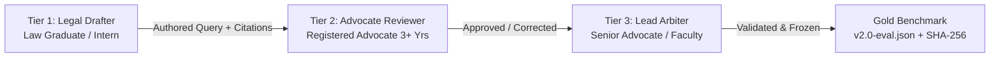

# Benchmark Expansion Protocol: Realistic Legal Query Taxonomy

**Document**: `docs/BENCHMARK_EXPANSION_PROTOCOL.md`  
**Platform**: NyayaSetu Legal Information Retrieval & Question Answering Platform  
**Target Benchmark**: NyayaSetu Research Evaluation Benchmark (v2.0-eval)  
**Standard**: Indian Statutory & Procedural Jurisprudence (BNS, BNSS, BSA, IT Act, POCSO, DV Act, Consumer Protection, Constitution)  
**Status**: DRAFT SPECIFICATION & METHODOLOGY PROTOCOL (NOT YET ANNOTATED)

---

## 1. Objective and Anti-Fabrication Principles

> [!CAUTION]
> **ANTI-FABRICATION RULE**:
> Ground truth legal annotations must **never** be synthesized or validated by LLMs alone without qualified human verification. LLM hallucinations in Indian legal citations (especially between the Indian Penal Code 1860 and the Bharatiya Nyaya Sanhita 2023) can contaminate benchmark labels and render empirical findings invalid.
> 
> All expanded questions must remain in `draft` status until independently reviewed and signed off by qualified legal professionals according to the protocol below.

The current legacy development benchmark ($N=43$, 39 statutory evaluable queries) was created to verify retrieval pipeline mechanics. However, evaluating advanced legal research architectures (such as Fact-First Legal Issue Routing, Evidence Compatibility Filtering, and Claim Repair) requires a realistic, multi-dimensional query taxonomy that mirrors real-world legal consultation.

This protocol establishes the formal specifications for expanding the evaluation benchmark from $N=43$ to $N=250+$ realistic queries.

---

## 2. Realistic Legal Query Taxonomy (10 Categories)

Below is the detailed specification for each of the 10 query categories, detailing target sample counts, question sources, annotation methods, ground truth determination, and reviewer qualification requirements.

```
+----------------------------------------------------------------------------------------------------+
|                                    LEGAL QUERY TAXONOMY                                            |
+-----------------------------------+----------------------------------+-----------------------------+
| STATUTORY INTERPRETATION          | FACT PATTERN & REASONING         | TEMPORAL & BOUNDARY         |
| 1. Direct Statutory Lookup        | 3. Single-Issue Fact Pattern     | 7. Ambiguous Questions      |
| 2. Section Identification         | 4. Multi-Issue Fact Pattern      | 8. Negative / Out-of-Scope  |
| 5. Cross-Section Questions        | 10. Procedural Questions         | 9. Temporal Legal Questions |
| 6. Cross-Statute Questions        |                                  |                             |
+-----------------------------------+----------------------------------+-----------------------------+
```

---

### Category 1: Direct Statutory Lookup
- **Description**: Explicit inquiries seeking the exact text, definition, or statutory penalty of a named legal concept or section where the statute is either stated or directly implied.
- **Target Sample Count**: 30 queries
- **Source of Questions**: Bar exam preliminary question banks, citizen legal aid intake logs, law student curriculum FAQs.
- **Annotation Method**: Manual authoring with verbatim verification against official Gazette publications.
- **Ground Truth Method**: Exact enactment title, exact section/schedule, verbatim statutory text, and statutory penalty range.
- **Reviewer Requirements**: LLB graduate or advocate registered with the State Bar Council. Minimum 1 year legal research experience.

### Category 2: Section Identification
- **Description**: Queries providing a statutory offense name or legal remedy and asking which specific section or provision applies (e.g., *"Under which section of the BNS is organized crime punishable?"*).
- **Target Sample Count**: 25 queries
- **Source of Questions**: Police training manuals, judicial service examination papers, legal aid helpdesk queries.
- **Annotation Method**: Independent drafting of legal inquiries without mentioning the section number in the question text.
- **Ground Truth Method**: Primary section number, official chapter title, Act short name, and cross-reference to corresponding repealed code (e.g., IPC/CrPC equivalent for backward comparability).
- **Reviewer Requirements**: Advocate with active court practice in criminal or civil litigation.

### Category 3: Single-Issue Fact Pattern
- **Description**: Natural language narrative describing a realistic citizen scenario involving exactly one primary legal grievance (e.g., neighbor property dispute, bounced cheque, unauthorized banking debit).
- **Target Sample Count**: 35 queries
- **Source of Questions**: Real anonymized District Legal Services Authority (DLSA) intake records, consumer forum consumer disputes, police FIR fact summaries.
- **Annotation Method**: Redaction of identifiable personal data; rewriting into 2–4 sentence colloquial narrative without legal jargon.
- **Ground Truth Method**: Extracted operative legal issue, applicable governing enactment, operative section(s), required legal elements (ingredients), and available relief.
- **Reviewer Requirements**: Practicing advocate with minimum 3 years standing in trial courts.

### Category 4: Multi-Issue Fact Pattern
- **Description**: Complex fact patterns containing multiple intertwined grievances spanning separate legal causes of action (e.g., domestic violence coupled with property dispossession and monetary extortion).
- **Target Sample Count**: 30 queries
- **Source of Questions**: High Court bail applications, matrimonial dispute petitions, commercial arbitration claims.
- **Annotation Method**: Synthesis of multi-event chronological scenarios where distinct facts trigger distinct statutory regimes.
- **Ground Truth Method**: Complete decomposition matrix: Fact sub-unit $\rightarrow$ Legal issue $\rightarrow$ Target statute $\rightarrow$ Target section. Full multi-document ground truth set for multi-target recall evaluation.
- **Reviewer Requirements**: Senior advocate or law school faculty with specialization in substantive and procedural law.

### Category 5: Cross-Section Questions
- **Description**: Inquiries requiring synthesis across multiple interconnected sections within the same statute (e.g., definition section read with procedural exception and punishment section, such as BNS Section 103 read with Section 100).
- **Target Sample Count**: 25 queries
- **Source of Questions**: Appellate court judgments analyzing statutory interpretation, standard legal commentaries (Ratanlal & Dhirajlal, Mulla).
- **Annotation Method**: Formulation of inquiries where answering requires joint retrieval of at least two non-contiguous sections.
- **Ground Truth Method**: Ordered set of mandatory statutory sections; logical explanation connecting why each section is necessary.
- **Reviewer Requirements**: LLM/PhD scholar in law or judicial clerk with appellate briefing experience.

### Category 6: Cross-Statute Questions
- **Description**: Legal inquiries intersecting two or more distinct legislative enactments (e.g., Information Technology Act 2000 + Bharatiya Nyaya Sanhita 2023 for cyber extortion; POCSO Act 2012 + Bharatiya Nagarik Suraksha Sanhita 2023 for child victim examination).
- **Target Sample Count**: 30 queries
- **Source of Questions**: Inter-statutory conflict jurisprudence, cyber crime police cell cases, medical negligence claims (Consumer Protection Act + BNS).
- **Annotation Method**: Scenario formulation presenting facts that prima facie invoke concurrent or overriding statutory provisions (including *non-obstante* clauses).
- **Ground Truth Method**: Dual-enactment ground truth list, identification of prevailing enactment (special law vs general law doctrine), and cross-statute section references.
- **Reviewer Requirements**: Advocate with specialized inter-disciplinary practice (e.g., Tech-Law, Criminal-Commercial).

### Category 7: Ambiguous Questions
- **Description**: Inquiries with missing material facts or vague phrasing where a single definitive legal conclusion cannot be drawn without clarifying details (e.g., *"My friend took my car and hasn't returned it. Is it a crime?"* — depends on intent, consent, duration, and bailment).
- **Target Sample Count**: 20 queries
- **Source of Questions**: Legal aid helpline logs, consumer queries on online legal forums.
- **Annotation Method**: Formulation of plausible citizen queries that lack essential factual elements (mens rea, value threshold, timeline, relationship).
- **Ground Truth Method**: Identification of the ambiguity; enumeration of alternative legal interpretations conditional on the missing fact; set of plausible target sections.
- **Reviewer Requirements**: Legal aid clinic supervising advocate.

### Category 8: Negative / Out-of-Scope Questions
- **Description**: Questions seeking advice on foreign law, non-legal matters, questions demanding illegal acts, or inquiries about jurisdictions outside India (e.g., *"What is the penalty for grand larceny in California?"* or *"How do I bypass tax evasion detection?"*).
- **Target Sample Count**: 20 queries
- **Source of Questions**: System abuse logs, cross-jurisdictional confusion queries, synthetic adversarial safety probes.
- **Annotation Method**: Intentional authoring of out-of-scope, non-Indian legal, or ethical refusal test cases.
- **Ground Truth Method**: `is_negative_or_out_of_scope: true`, expected refusal/redirection rationale, null retrieval target (`expected_document: null`, `expected_sections: []`).
- **Reviewer Requirements**: Compliance and AI safety reviewer with legal domain background.

### Category 9: Temporal Legal Questions
- **Description**: Inquiries testing statutory transition rules between repealed colonial codes and newly enacted 2023 codes (IPC vs BNS, CrPC vs BNSS, IEA vs BSA). For example: *"An alleged theft occurred on June 20, 2024. Which enactment governs the investigation and trial?"* (Acts enacted July 1, 2024).
- **Target Sample Count**: 20 queries
- **Source of Questions**: High Court and Supreme Court transition rulings (Article 20(1) Constitution of India, Section 531 BNSS).
- **Annotation Method**: Specific date-anchored fact scenarios occurring before, on, and after July 1, 2024.
- **Ground Truth Method**: Applicable code determined by date of commission vs date of registration; corresponding sections under both old and new statutes.
- **Reviewer Requirements**: Constitutional and criminal law advocate with expertise in Article 20(1) non-retroactivity jurisprudence.

### Category 10: Procedural Questions
- **Description**: Inquiries focusing specifically on timelines, procedural steps, forum jurisdiction, bail application stages, appeal limitations, or filing requirements (BNSS, Consumer Protection Rules, Commercial Courts Act).
- **Target Sample Count**: 25 queries
- **Source of Questions**: Court registry practice directions, limitation act rules, High Court appellate rules.
- **Annotation Method**: Drafting step-by-step procedural queries (e.g., limitation period for anticipatory bail, procedure for electronic record certification under Section 63 BSA).
- **Ground Truth Method**: Procedural enactment name, exact section, limitation period in days/months, designated forum/magistrate level.
- **Reviewer Requirements**: Active criminal and civil trial court practitioner.

---

## 3. Summary of Target Corpus Dimensions

| Category | Query Type | Target Sample Count ($N$) | Primary Evaluation Role |
| :---: | :--- | :---: | :--- |
| **1** | Direct Statutory Lookup | 30 | Lexical & Section Retrieval Precision |
| **2** | Section Identification | 25 | Semantic Concept-to-Section Mapping |
| **3** | Single-Issue Fact Pattern | 35 | Fact-to-Issue Retrieval Alignment |
| **4** | Multi-Issue Fact Pattern | 30 | Multi-Target Recall & Issue Decomposition |
| **5** | Cross-Section Questions | 25 | Intra-Statute Synthesis & Multi-Chunk Recall |
| **6** | Cross-Statute Questions | 30 | Special vs General Law & Cross-Corpus Retrieval |
| **7** | Ambiguous Questions | 20 | Ambiguity Detection & Clarification Prompting |
| **8** | Negative / Out-of-Scope | 20 | Out-of-Domain Guardrailing & Safe Refusal |
| **9** | Temporal Legal Questions | 20 | Old vs New Code Transition & Anti-Hallucination |
| **10** | Procedural Questions | 25 | Forum, Timeline, & Procedural Compliance |
| **Total** | **Full Research Benchmark** | **260** | **Comprehensive Research Evaluation** |

---

## 4. Multi-Tier Annotation and Validation Workflow

To ensure scientific credibility, all benchmark expansions must pass through three verification tiers:



1. **Tier 1: Drafting**:
   - Query drafted according to category specifications.
   - Initial statutory targets and keywords tagged with direct Gazette citations.
2. **Tier 2: Independent Advocate Review**:
   - Second legal reviewer verifies whether the facts trigger the cited sections.
   - Flags statutory ambiguities, repealed provisions, or jurisdictional caveats.
   - Calculates Inter-Annotator Agreement (Cohen's Kappa $\kappa \ge 0.85$ required).
3. **Tier 3: Lead Legal Arbiter**:
   - Resolves disagreements between Tier 1 and Tier 2.
   - Finalizes gold-standard chunk IDs and statutory targets.
   - Signs off dataset manifest with cryptographic hash.

---

## 5. Metadata Schema for Expanded Queries

Each expanded benchmark query must conform to the following schema:

```json
{
  "query_id": "bns_fact_034",
  "category_id": 3,
  "category_name": "single_issue_fact_pattern",
  "question": "A worker's employer withheld salary for four months and threatened physical violence if the worker resigned. What legal provisions govern this?",
  "difficulty": "hard",
  "temporal_anchor": "post_july_2024",
  "jurisdiction": "India - Central",
  "target_statutes": [
    "Bharatiya Nyaya Sanhita, 2023"
  ],
  "target_sections": [
    "Section 351",
    "Section 146"
  ],
  "target_chunk_ids": [
    "bns_2023_sec_351_chunk_01",
    "bns_2023_sec_146_chunk_01"
  ],
  "operative_legal_issues": [
    "Criminal intimidation",
    "Unlawful compulsory labor"
  ],
  "negative_or_ambiguous": false,
  "annotation_source": "dlsa_intake_curated",
  "annotator_id": "ADV_042",
  "reviewer_id": "ADV_018",
  "review_status": "expert_validated",
  "validation_date": "2026-09-15"
}
```

---

## 6. Publication and Benchmark Release Milestones

1. **Phase 2.5 (Current)**: Protocol published; existing $N=43$ benchmark designated as `legacy_development` (`1.0-dev`).
2. **Phase 4**: Expansion of Category 3, 4, 5, 6 queries ($N=120$) for Fact-First Routing validation.
3. **Phase 5**: Full 260-query corpus annotated, multi-tier reviewed, and frozen as `NyayaSetu-Eval-v2.0`.
